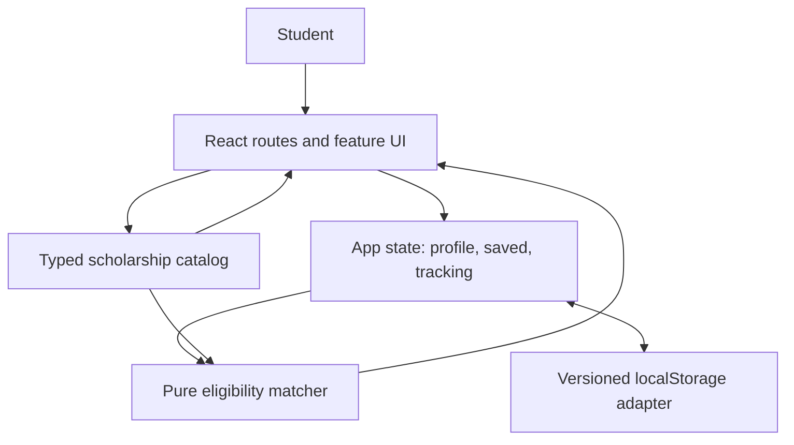

# GRANTLY — Frontend Architecture

**Status:** Target architecture, not implemented code.  
**References:** [MVP](MVP.md) · [PRD](PRD.md) · [Testing](TESTING.md) · [Security](SECURITY.md)

## Architecture decision

Use a modern **client-side React + TypeScript + Vite** application, styled with Tailwind CSS and accessible reusable components. Keep all core scholarship interactions functional without a backend. Use typed example data and local browser persistence strictly as a hackathon demonstration.

Do **not** implement fake authentication or require a password. A student profile is local application state, **not** an authenticated identity. Cross-device sync and application-provider integrations are explicitly absent.

## Component and data flow



## Suggested modules

```text
src/
  app/             routes, app shell, providers, navigation
  components/ui/   accessible primitives, cards, buttons, feedback
  features/
    dashboard/     overview and next-action summaries
    discovery/     queries, filters, sort, opportunity cards
    scholarship/   detail, criteria, documents, provider links
    profile/       student profile form and edits
    matching/      criterion evaluation and explanations
    applications/  save, stages, checklist, deadlines
  data/            typed illustrative scholarships
  lib/             formatting, date logic, storage adapter, validation
  styles/          tokens and global styling
```

This is a starting structure, not a requirement to create empty folders. Keep files and abstractions proportional to working functionality.

## Core typed entities

- **StudentProfile:** educationLevel, fieldOfStudy, region, optional academic/income attributes, schemaVersion.
- **Scholarship:** stable ID, title, provider, program description, amount/benefit, currency if applicable, eligibilityRules, requiredDocuments, applicationSteps, deadline?, sourceUrl?, isSample.
- **EligibilityCriterion:** field, operator, expectedValue, explanation and optionality as appropriate.
- **FitAssessment:** list of outcomes (`match`, `unknown`, `possible_mismatch`) and concise summary; unknown never counts as a match.
- **TrackedApplication:** scholarshipId, stage (`saved`, `preparing`, `applied`, `decision_received`), checklist state, notes?, lastUpdated.
- **PersistedState:** version, profile, trackedApplications.

Do not implement a single opaque match percentage unless there is a defensible and explicitly documented method. Explanations are the product.

## State management

Use React state/context or a small purpose-built store if needed; no heavy dependency is required. Derive filtered catalog views, counts, urgency and eligibility assessments from shared canonical state rather than copying them into several mutable stores.

- One scholarship ID uniquely identifies each opportunity across screens.
- Save/unsave and stage updates are centralized, so updates appear everywhere.
- Document checklist updates are associated with specific scholarship IDs.
- Deadline labels are computed from parsed dates, not hardcoded as “soon”.
- Guard unknown/missing data, invalid dates and expired opportunities.
- Use pure functions for matching, sorting and next-action logic; write unit tests.

## Persistence contract

Use versioned, namespaced browser storage, for example `grantly:demo:v1`. Validate/decode at read boundaries. If storage is corrupted, unavailable, or blocked, the UI must recover gracefully and explain reduced persistence when relevant. Offer a reset demo action.

Never store passwords, access tokens, raw financial identifiers, identity documents or sensitive uploads in localStorage. Keep optional demographic/financial details minimal and allow users to skip them. A browser refresh in the same profile should preserve demo state; private mode and device changes are not supported.

## Routing and deployment

Expected routes (adapt if necessary):

- `/` — dashboard or introductory route
- `/discover` — scholarship discovery
- `/scholarships/:id` — scholarship details
- `/applications` — tracker
- `/profile` — profile

Deep links and refresh must work at the deployment host: configure SPA fallback or choose compatible static routing. Provide an accessible “not found” route for unknown IDs.

## External information boundary

All seed catalog records are illustrative and labeled accordingly. If real scholarships are included, provide sourced information and official destination links, with explicit uncertainty about timeliness. Do not imply scraping, live updates or actual application transmission.

## Performance and reliability

- Use small static fixture data; avoid unnecessary backend/API dependencies.
- Keep navigation fast and deterministic.
- Avoid heavy animation/graphics that reduce clarity.
- Use loading indicators only for real asynchronous work.
- Production build should be reproducible with a documented package manager and lockfile.

## Architecture evolution (not MVP)

If GRANTLY becomes a production multi-user platform, add authenticated accounts, trusted scholarship ingestion, provider verification, server-side access control, database persistence, explicit consent and retention policies. These are *not* current features.
