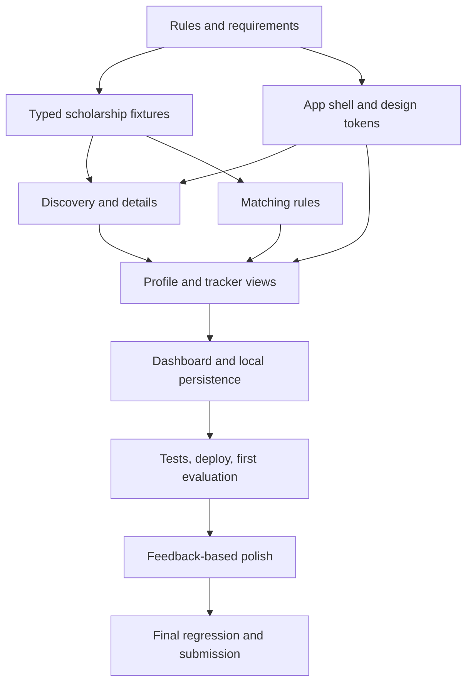

# GRANTLY — Implementation Plan

**Status:** Plan only; no completed implementation claimed.  
**Timebox:** One individual builder, six hours from the organizer-confirmed start.  
**Read first:** [ideas.md](ideas.md), [MVP.md](MVP.md), [PRD.md](PRD.md), [ARCHITECTURE.md](ARCHITECTURE.md), [UI_UX.md](UI_UX.md), and the upcoming design file.

## Operating principle

**Problem alignment → Complete functional journey → Accessible responsive polish → Score-driven iteration.** Do not trade mandatory user outcomes for unrequested features. Do not write competition solution code outside the permitted window.

## Phase 0 — Brief audit and setup (target 0:00–0:25)

- Recheck the official problem statement and announcements; note hard rules, deliverables and any evaluator-specific restrictions.
- Create the actual application within the allowed window.
- Choose the final layout and tokens based on the user-provided `design.md`; do not copy unrelated branding or job-search flows.
- Establish TypeScript, Vite, React, Tailwind, lint/build scripts, routing, folder structure, and an early deploy path.
- Write down a requirement/feature acceptance checklist from [PRD.md](PRD.md).

**Exit:** App starts locally; routing and deployment strategy are known.

## Phase 1 — Data & discovery (target 0:25–1:35)

- Define typed scholarship data, profile criteria and tracking types.
- Add varied, clearly labeled sample opportunities (including unknown, expired and differing criteria).
- Implement application shell, navigation, catalog cards, search, filter and sorting.
- Implement scholarship detail route (including direct-open and refresh behavior).

**Exit:** User can explore a catalog and find accurate detail content; no dead controls.

## Phase 2 — Full end-to-end workflow (target 1:35–2:30)

- Build editable student profile with optional fields and valid unknown states.
- Implement pure, testable criteria evaluation with explanatory output.
- Connect save/unsave and application status transitions.
- Build tracker and dashboard summary; persist local state safely.
- Keep sample/demo and local persistence disclaimers visible.

**Exit:** Profile → discovery → detail → save → preparation → dashboard works.

## Phase 3 — First validated submission (target 2:30–3:00)

- Run typecheck/lint/build and smoke-test desktop/mobile.
- Test profile edits, filtering, unknown eligibility, save/refresh and tracking.
- Deploy and validate the public route; follow the *current* organizer submission instructions.
- Submit a valid version early **if attempts and time allow**; record timestamp, commit, score and feedback.

**Exit:** Evaluator has a functional, complete product to assess.

## Phase 4 — Iterative improvement (target 3:00–5:15)

Improvement priority:
1. Any missing behavior that the challenge explicitly calls for.
2. Broken interactions, navigation, data consistency or persistence.
3. Weak clarity in explanation of options / application steps / next actions.
4. Mobile layout, keyboard access, contrast and visual hierarchy.
5. Meaningful microinteractions and optional features.

After each substantial change: rerun relevant tests, capture a working Git commit, compare score and feedback, avoid changing several unrelated dimensions in one experiment when possible.

**Never assume** unlimited attempts, feedback breakdown, or “best score wins.” Confirm rules. If latest-submission-wins, a lower score can replace a higher one.

## Phase 5 — Freeze and submit (target 5:15–6:00)

- Stop adding features; run full regression checks and validate deployment.
- Confirm no illustrative data is represented as official/open.
- Verify desktop and mobile primary journey, navigation, refresh and empty states.
- Preserve the last known good version and submit according to current ranking/attempt rules.
- Record repo, deployed link, evaluator receipt/score and any required submission metadata.

## Workstream order and dependency map



## Initial repository structure (suggested, not mandatory)

```text
src/
  app/             routing, shell, providers
  components/      accessible reusable controls
  features/
    discovery/
    scholarship/
    profile/
    matching/
    tracker/
    dashboard/
  data/            sample catalog and metadata
  lib/             date utilities, storage validation
  styles/          tokens, global CSS
docs/              requirements and contracts
```

Keep complexity proportionate. Feature folders are useful only if they reduce confusion; do not introduce an elaborate state manager or backend just to appear sophisticated.

## Failure modes and mitigation

| Risk | Mitigation |
| --- | --- |
| Aesthetic work crowds out functionality | Finish P0 before advanced animation and P1/P2 features |
| False scholarship/eligibility claims | Label demo data, show rule explanations and unknowns |
| Late first submission | Deploy a working vertical slice early; keep an explicit submission buffer |
| Unbounded evaluator optimization | Log scores and exact changed version; preserve known-good commits |
| Wrong assumptions about scoring | Check current platform instructions and adapt |
| Browser storage errors or corrupt state | Safe parse, schema/version guard, fallback and reset |
| Mobile layout or inaccessible controls | Smoke-test throughout development, not just at the end |

## Definition of done

See [MVP.md](MVP.md) for P0 scope, [TESTING.md](TESTING.md) for the release checklist and [DEMO.md](DEMO.md) for the judge-facing walkthrough. “Implemented” requires code plus validation evidence.
